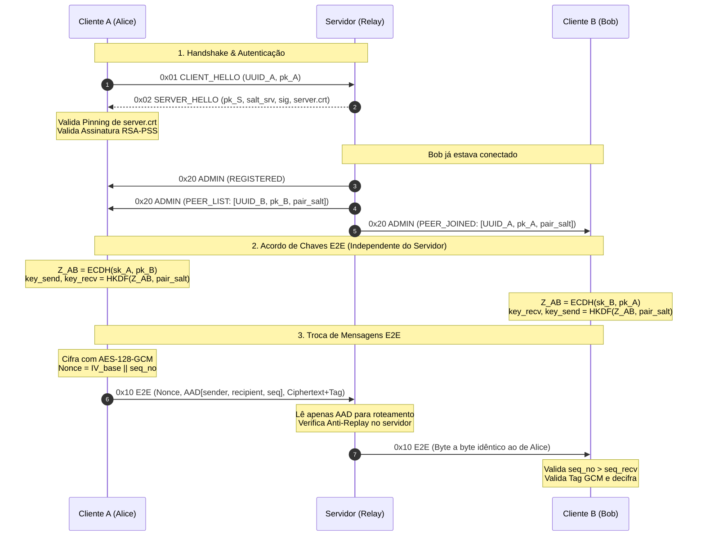

# Arquitetura Técnica, Fluxos e Criptografia do UatisApple

Documento técnico com a explicação detalhada de cada módulo do cliente e do servidor, seus fluxos de comunicação, primitivas criptográficas e defesas contra ataques.

---

## 1. Visão Geral da Arquitetura

O **UatisApple** é um sistema de mensageria segura multi-cliente baseado no modelo de **Servidor Relay com Criptografia de Ponta a Ponta (E2EE)**.

```mermaid
flowchart TD
    subgraph Cliente_A ["Cliente A (Alice)"]
        CA_Keys["Par X25519 Efêmero (sk_A, pk_A)"]
        CA_E2E["AES-128-GCM (key_A2B / key_B2A)"]
    end

    subgraph Servidor ["Servidor Relay (Uatisapple Server)"]
        S_Ident["Identidade RSA-3072 + Certificado"]
        S_Admin["Canal Admin Cifrado (Key_S2C)"]
        S_Relay["Roteador Cego de Frames E2E (0x10)"]
    end

    subgraph Cliente_B ["Cliente B (Bob)"]
        CB_Keys["Par X25519 Efêmero (sk_B, pk_B)"]
        CB_E2E["AES-128-GCM (key_A2B / key_B2A)"]
    end

    CA_Keys -.->|"1. Handshake & Pinning"| S_Ident
    CB_Keys -.->|"1. Handshake & Pinning"| S_Ident

    S_Admin -->|"2. Distribui pk_B e pair_salt"| Cliente_A
    S_Admin -->|"2. Distribui pk_A e pair_salt"| Cliente_B

    Cliente_A ==="3. Frame E2E Cifrado (Opaco para o servidor)"===> S_Relay
    S_Relay ==="4. Encaminha byte-a-byte idêntico"===> Cliente_B
```

* **Servidor Relay (Zero-Knowledge):** Autentica-se para os clientes, distribui metadados de presença por canal administrativo seguro e roteia frames E2E **sem possuir chaves para decifrá-los**.
* **Clientes:** Geram chaves locais efêmeras, autenticam o servidor via **Certificate Pinning** e **RSA-PSS**, negociam segredos compartilhados por par de clientes e cifram as mensagens com **AES-128-GCM**.

---

## 2. A Camada Criptográfica

| Algoritmo / Primitiva | Função no Sistema | Onde é Usado |
| :--- | :--- | :--- |
| **RSA-3072 com RSA-PSS** | Assinatura digital do servidor para autenticação mútua | Handshake inicial (`SERVER_HELLO`) |
| **Certificate Pinning** | Garantir que o certificado recebido é exatamente o do servidor confiável | Cliente validação de `server.crt` |
| **X25519 (ECDH efêmero)** | Acordo de chaves Diffie-Hellman em curva elíptica | Entre Cliente-Servidor e Cliente-Cliente |
| **HKDF-SHA256 (RFC 5869)** | Derivação determinística de chaves simétricas | Geração de `Key_S2C`, `key_A2B` e `key_B2A` |
| **AES-128-GCM (AEAD)** | Cifragem autenticada com dados adicionais associados | Mensagens administrativas e frames E2E |
| **Contadores de Sequência (`seq_no`)** | Ordenação estrita e unicidade do Nonce | Prevenção contra Replay Attack |

### 2.1 Derivação Direcional de Chaves (`key_A2B` e `key_B2A`)
Para evitar **reuso de keystream** e **ataques de reflexão**, cada par de clientes estabelece duas chaves simétricas distintas:
* `key_A2B`: usada quando A transmite para B.
* `key_B2A`: usada quando B transmite para A.

A atribuição dos papéis é determinística:
$$\text{O cliente é A se: } \text{client\_id}_{\text{local}} < \text{client\_id}_{\text{peer}} \text{ (comparação de 16 bytes)}$$

---

## 3. Componentes do Servidor (`uatisapple-server`)

### 3.1 Framing TCP — [`src/network.py`](file:///home/marco/uatisapple-server/src/network.py)
Mensagens trafegam com um cabeçalho de 4 bytes (*big-endian*) informando o comprimento exato do corpo:
```
[ Comprimento (4B uint32) ] || [ Tipo (1B) || Corpo (N Bytes) ]
```
A função `recv_msg` impede ataques de esgotamento de recursos rejeitando tamanhos anômalos (`> 64 KB` ou frames incompletos após timeout de 10s).

### 3.2 Identidade e Canal Administrativo — [`src/crypto.py`](file:///home/marco/uatisapple-server/src/crypto.py)
* **Assinatura RSA-PSS:** O servidor assina digitalmente o hash da sessão:
  $$H = \text{SHA-256}(\text{pk\_server} \parallel \text{pk\_client} \parallel \text{client\_id} \parallel \text{salt})$$
* **Chave `Key_S2C`:**
  Derivada via HKDF a partir do segredo ECDH entre a chave efêmera do servidor e a chave do cliente:
  $$\text{Key\_S2C} = \text{HKDF-SHA256}(\text{salt} = \text{salt\_srv}, \text{IKM} = \text{X25519}(\text{sk}_S, \text{pk}_C), \text{info} = \text{"S2C"}, L = 16)$$

### 3.3 Protocolo e Limites — [`src/protocol.py`](file:///home/marco/uatisapple-server/src/protocol.py)
* `0x01` (`CLIENT_HELLO`): 49 bytes (`0x01 || client_id (16B) || pk_C (32B)`).
* `0x02` (`SERVER_HELLO`): `0x02 || pk_S (32B) || salt (16B) || sig_len (2B) || sig || cert_len (2B) || cert`.
* `0x10` (`E2E`): Frame de dados ponta a ponta.
* `0x20` (`ADMIN`): Mensagens de controle servidor $\to$ cliente cifradas com `Key_S2C`.

### 3.4 Sessões e Roteamento — [`src/server.py`](file:///home/marco/uatisapple-server/src/server.py)
* **Handshake e Registro:** Recebe `CLIENT_HELLO`, valida unicidade do `client_id`, gera chaves efêmeras e envia `SERVER_HELLO`.
* **Geração de `pair_salt`:** Gera um salt único de 16 bytes para cada par de clientes e notifica via `PEER_LIST` e `PEER_JOINED`.
* **Roteamento E2E cego (`_relay`):** Inspeciona apenas os primeiros 52 bytes (`sender_id`, `recipient_id`, `seq_no`), valida anti-replay e encaminha os bytes brutos ao destinatário sem decifrar.

---

## 4. Componentes do Cliente (`uatisapple-Cliente`)

### 4.1 Framing de Rede — [`src/network.py`](file:///home/marco/uatisapple-Cliente/src/network.py)
* `enviar_frame_tcp(sock, payload)`: Adiciona o prefixo de 4 bytes big-endian e envia via socket.
* `receber_frame_tcp(sock)`: Lê o cabeçalho de 4 bytes e aguarda exatamente o número de bytes anunciado.

### 4.2 Criptografia do Cliente — [`src/crypto.py`](file:///home/marco/uatisapple-Cliente/src/crypto.py)
* **`gerar_chaves_efemeras()`:** Gera o par X25519 garantindo *Perfect Forward Secrecy* (PFS).
* **`verificar_handshake_servidor(...)`:** Executa o *Certificate Pinning* comparando byte a byte com [`certs/server.crt`](file:///home/marco/uatisapple-Cliente/certs/server.crt) e valida a assinatura RSA-PSS com SHA-256.
* **`calcular_segredo_e_derivar_chaves(...)`:** Realiza o cálculo Diffie-Hellman $Z_{AB} = \text{X25519}(\text{sk}_{\text{local}}, \text{pk}_{\text{peer}})$ e deriva `key_a2b` e `key_b2a` via HKDF.
* **`cifrar_mensagem_e2e(...)`:**
  * Incrementa `seq_send`.
  * Nonce (12B): `IV_base_send (4B) || seq_no (8B)`.
  * AAD (40B): `sender_id (16B) || recipient_id (16B) || seq_no (8B)`.
  * Cifra o plaintext com AES-128-GCM e retorna `0x10 || Nonce || AAD || Ciphertext + Tag (16B)`.
* **`decifrar_mensagem_e2e(...)`:**
  * Valida monotonicidade (`seq_no > seq_recv_atual`).
  * Decifra e valida a Tag GCM de 16 bytes (garantia anti-tampering).

### 4.3 Ponto de Entrada — [`main.py`](file:///home/marco/uatisapple-Cliente/main.py)
Orquestra o handshake com o servidor, simula a formação de sessão E2E e executa os testes obrigatórios de integridade e replay.

---

## 5. Fluxo Completo de Interações



---

## 6. Provas Práticas de Segurança

O script [`main.py`](file:///home/marco/uatisapple-Cliente/main.py#L104-L120) do cliente comprova a proteção ativa:

1. **Anti-Tampering (Bitflip):**
   Ao alterar um único bit da Tag de autenticação GCM, a decifragem falha imediatamente levantando `InvalidTag`:
   ```python
   frame_adulterado[-1] ^= 0xFF
   # Decifragem rejeita o frame adulterado com sucesso
   ```
2. **Anti-Replay:**
   Ao tentar reinserir um frame com `seq_no` já recebido (`seq_no <= seq_recv_atual`), o pacote é descartado sumariamente:
   ```python
   if seq_no <= seq_recv_atual:
       raise ValueError("[-] REJECTED: Ataque Replay detectado!")
   ```
